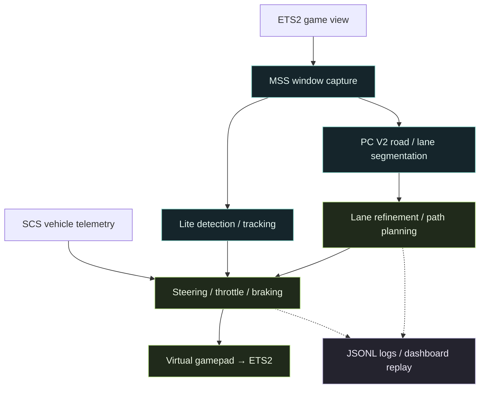

<div align="center">


### See the road. Plan the path. Drive the loop.

A vision-based driving experiment · From model training to ETS2 control and frame-by-frame replay

[简体中文](README.md) · **English**

[](requirements.txt)
[](Models/pc_v2.py)


[Highlights](#highlights) · [Pipeline](#pipeline) · [Quick start](#quickstart) · [Models & training](#training) · [Code map](#code-map)

</div>

---

**Universal Autopilot (26SV)** implements a driving assistance pipeline with inspectable intermediate steps. Neural networks turn screen pixels into roads, lanes and objects. Planning and control turn those predictions into virtual gamepad inputs. Logs preserve the intermediate state so you can inspect how a steering or braking decision happened, one frame at a time.

The current runtime integrates with **Euro Truck Simulator 2 on Windows**. The repository includes custom PyTorch networks, BDD100K training code, inference weights, a local dashboard and offline tests. “Universal” describes the direction of the project; other games need their own capture, telemetry and control integration.

<a id="highlights"></a>

## A driving pipeline you can inspect

| Perception | Planning & Control | Inspection & Replay |
| :--- | :--- | :--- |
| **Dual-head segmentation**: shared features with separate road / car and lane predictions | **Lane centering**: lane fitting, center paths and speed-dependent look-ahead steering | **Perception dashboard**: lanes, paths, objects and vehicle state in one view |
| **Three-class detection**: pedestrians, cars and trucks, with NMS and object tracking | **Requested lane changes**: paths based on visible lanes and the current planning state | **Frame diagnostics**: steering, throttle, brake, telemetry and braking reasons |
| **Common visual input**: RGB at 640 × 352; segmentation helps filter car detections | **Longitudinal control**: target-speed PI throttle and visual TTC braking | **Log replay**: select runs, scrub the timeline, change playback speed and export frames |

### A real interface, beyond model outputs

<picture>
  <source media="(prefers-color-scheme: dark)" srcset="UI/preview-dark.jpg">
  <source media="(prefers-color-scheme: light)" srcset="UI/demo.jpg">
  
</picture>

<p align="center"><sub>Recorded-run screenshot from the repository · Light and dark themes · Speed and FPS are single-frame values, not benchmark results</sub></p>

The dashboard draws lanes, paths and detections in image coordinates and can also display the runtime’s `Result` window. It reads existing outputs; pausing the webpage only pauses its display. Historical logs contain geometry and state, not recorded video. See the [dashboard guide](UI/README.md) (Chinese) for details.

<a id="pipeline"></a>

## From pixels to control



Vision handles road and object perception; SCS telemetry supplies vehicle state such as speed. Steering and lane-change paths use image coordinates, while TTC is estimated from changes in object bounding boxes.

<a id="quickstart"></a>

## Quick start

### 1 · Get the project and dependencies

These commands use **Windows PowerShell**. Creating and using a Python virtual environment is recommended.

```powershell
git clone https://github.com/HenryG03124/Universal-Autopilot.git
cd Universal-Autopilot
python -m pip install -r requirements.txt
```

For GPU inference, follow the [official PyTorch installation guide](https://pytorch.org/get-started/locally/) to select a build for your hardware. The runtime selects an available device automatically; the full game capture and control pipeline uses Windows APIs.

**Inference weights are included in the repository.** You do not need to train the models first.

| File | Purpose |
| :--- | :--- |
| [`MyAutoPilot/weights/pc_model_v2_bdd100k.pth`](MyAutoPilot/weights/pc_model_v2_bdd100k.pth) | Road, car and lane segmentation |
| [`MyAutoPilot/weights/od_model_Lite.pth`](MyAutoPilot/weights/od_model_Lite.pth) | Pedestrian, car and truck detection |

### 2 · Open the dashboard

From the repository root:

```powershell
python -B -m UI.server
```

Open **[http://127.0.0.1:8765](http://127.0.0.1:8765)**, or double-click `UI/start.bat`. The interface needs no frontend build step or external CDN.

A fresh clone has no run logs, so there is initially nothing to replay. After MyAutoPilot runs, the dashboard reads JSONL files from `MyAutoPilot/logs/`; you can also place existing logs there. For the live view, keep the `Result` window visible and unobstructed. Window capture and log sampling are independent and are not guaranteed to be frame-synchronized.

### 3 · Configure the ETS2 integration

| Component | Required setup |
| :--- | :--- |
| Game window | The default title is `Euro Truck Simulator 2`; keep it visible, unobstructed and not minimized |
| Virtual controller | Follow the [vgamepad installation instructions](https://github.com/yannbouteiller/vgamepad) for the Windows driver; bind left-stick X to steering, right trigger to throttle and left trigger to brake in the game |
| Vehicle telemetry | Install a plugin compatible with [`truckermudgeon/scs-sdk-plugin`](https://github.com/truckermudgeon/scs-sdk-plugin) **revision 12**; the reader uses `Local\SCSTelemetry`. Its protocol reference is in [`scs_telemetry.py`](MyAutoPilot/scs_telemetry.py) |
| Monitor | [`main.py`](MyAutoPilot/main.py) defaults to `monitor_index = 2`; use `1` for a single-monitor setup. Window capture still requires a valid index |
| Control output | The default is `control = "enable"`; use `"disable"` while inspecting perception for the first time. Driving commands are then disabled, but the virtual gamepad is still created and needs its driver |

Missing, stale, paused or unsupported telemetry causes throttle control to return zero. Unbind the arrow keys from the game’s driving controls to avoid conflicts with the shortcuts below.

<details>
<summary><b>Optional: adjust ETS2 steering settings automatically</b></summary>

`autoconfig` is disabled by default in `main.py`. You can keep that default and run the configuration tool separately: exit ETS2, then run the following from the repository root, replacing the placeholder with the full path to your own `controls.sii`:

```powershell
python -c "from MyAutoPilot.auto_config import auto_config; auto_config(r'C:\path\to\your\controls.sii')"
```

This adjusts steering settings, removes left / right arrow driving bindings and saves a one-time `controls.sii.bak` backup. It does not replace gamepad axis configuration or remove up / down arrow driving bindings. Reopen the game afterward, then start MyAutoPilot.

</details>

### 4 · Start perception and control

Open another PowerShell in the **repository root**:

```powershell
$env:PYTHONPATH = (Get-Location).Path
Set-Location MyAutoPilot
python -B main.py
```

Keep this working directory: weights are loaded relative to `weights/`, while `PYTHONPATH` makes the root-level `Models` package importable.

| Input | Action |
| :---: | :--- |
| `←` / `→` | Request a left / right lane change, subject to lane availability and planning state |
| `↑` / `↓` | Increase / decrease the target speed by **5 km/h**; the initial target is **50 km/h** |
| `q` | Quit when the OpenCV `Result` window has keyboard focus |

<a id="training"></a>

## Models & training

| Module | Design | Training entry point |
| :--- | :--- | :--- |
| **PC V2** | Residual encoder + U-Net decoder; shared features for road / car and lane heads, with image-detail fusion in the lane branch | [`NetTrainer/pixel_classifier_v2/train.py`](NetTrainer/pixel_classifier_v2/train.py) |
| **Lite Detector** | Custom lightweight residual network; a 22 × 40 grid predicts boxes, objectness and three object classes | [`NetTrainer/object_detector/train_Lite.py`](NetTrainer/object_detector/train_Lite.py) |

PC V2 interleaves road and lane training, combining cross-entropy and Dice for the lane loss. The detector uses classification, focal objectness and CIoU regression losses. Training scripts keep data loading, training, validation, checkpoint saving and plotting explicit.

<details>
<summary><b>Dataset layout, training commands and weight outputs</b></summary>

All datasets live under `NetTrainer/datasets/` and are excluded from the repository. Obtain [BDD100K](https://www.bdd100k.com/) separately and prepare the required manifests and labels before training:

```text
NetTrainer/datasets/
├── pc_ds/                    # Original road / car segmentation data
├── processed_pc_ds/          # Road / car segmentation manifests and masks
├── pc_lane_ds/               # Raw BDD100K lane data
├── processed_pc_lane_ds/     # Lane segmentation manifests and masks
├── objdetect_ds/             # Original detection images
└── processed_objdetect_ds/   # Detection manifests and labels
```

Each `processed_*` training directory needs `train_pairs.csv` and `val_pairs.csv`. Lane preparation is available in [`prepare_pc_v2_bdd100k_ds.py`](NetTrainer/pixel_classifier_v2/prepare_pc_v2_bdd100k_ds.py); inspect its local input options with:

```powershell
python -m NetTrainer.pixel_classifier_v2.prepare_pc_v2_bdd100k_ds --help
```

The repository does not include the complete road / car or object-detection data preparation workflow. Their training scripts read already-prepared data. See the [detection training guide](NetTrainer/object_detector/README.md) (Chinese) for formats and loss details.

Once data is ready, run the desired task from the repository root:

```powershell
python -m NetTrainer.pixel_classifier_v2.train
python -m NetTrainer.object_detector.train_Lite
```

PC V2 saves weights and curves under `NetTrainer/pixel_classifier_v2/`. The detector saves `od_model_Lite.pth` and `figure_Lite.png` in the command’s working directory. To use newly trained models in the game, update the corresponding files in `MyAutoPilot/weights/` yourself.

</details>

<a id="code-map"></a>

## Code map

```text
Universal-Autopilot/
├── Models/                    # Shared PC V2 / Lite Detector definitions
├── MyAutoPilot/                # Capture → perception → planning → control
│   ├── main.py                # Runtime entry point and parameters
│   ├── weights/               # Included inference weights
│   ├── tests/                 # Offline tests, replay and profiling tools
│   └── logs/                  # Generated at runtime; ignored by Git
├── NetTrainer/                # Data loading, training, validation and plots
│   ├── pixel_classifier/      # Earlier segmentation experiments
│   ├── pixel_classifier_v2/   # Current dual-head segmentation training
│   ├── object_detector/       # Three-class detection training
│   └── datasets/              # Local training data; ignored by Git
└── UI/                        # Local driving perception dashboard
```

To understand a driving decision, start at [`main.py`](MyAutoPilot/main.py), trace [`lane_refiner.py`](MyAutoPilot/lane_refiner.py) → [`route_planner.py`](MyAutoPilot/route_planner.py) → [`steering.py`](MyAutoPilot/steering.py), then compare the log’s `path_points`, `steering_debug` and `brake_reason` fields.

Offline test entry points, run from the repository root:

```powershell
python -B -m unittest discover -s MyAutoPilot/tests -v
python -B -m unittest UI.test_server
```

See the [steering tests](MyAutoPilot/tests/test_steering.py) and [planning tests](MyAutoPilot/tests/test_route_planner.py) for individual checks. Offline checks validate individual behaviors; closed-loop behavior still requires in-game evaluation.

## Current scope & contributions

This is a driving assistance project for learning and experimentation. Lane-change availability is based on lane geometry and planning state, without complete side / rear traffic checks. Visual TTC is not radar ranging, and full route navigation or intersection decision-making is not implemented. Results depend on the models, camera view, occlusion and hardware performance.

Reproducible [issues](https://github.com/HenryG03124/Universal-Autopilot/issues) and focused [pull requests](https://github.com/HenryG03124/Universal-Autopilot/pulls) improving models, control or documentation are welcome. Include your environment, configuration and relevant log excerpts when reporting a problem.

Built with [PyTorch](https://pytorch.org/), [OpenCV](https://opencv.org/), [MSS](https://github.com/BoboTiG/python-mss), [vgamepad](https://github.com/yannbouteiller/vgamepad), [BDD100K](https://www.bdd100k.com/) and [SCS SDK Plugin](https://github.com/truckermudgeon/scs-sdk-plugin). Datasets, third-party components and game content remain subject to their respective terms.

---

<p align="center"><b>From pixels to driving decisions.</b><br><sub>Universal Autopilot · 26SV</sub></p>
