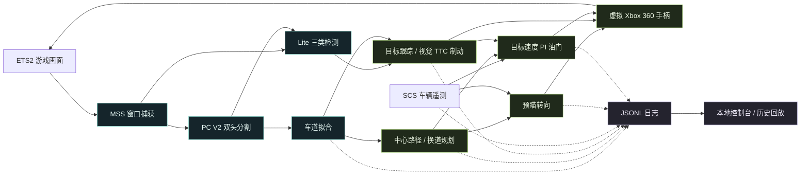

<div align="center">


### 看见道路，理解路径，输出控制。

基于视觉的驾驶辅助实验 · 从模型训练到 ETS2 控制，再到每一帧的可视化回放

**简体中文** · [English](README.en.md)

[](requirements.txt)
[](Models/pc_v2.py)


[项目亮点](#highlights) · [系统流程](#pipeline) · [快速开始](#quickstart) · [模型与训练](#training) · [代码导览](#code-map)

</div>

---

**Universal Autopilot（26SV）** 把一条驾驶辅助链路拆开、实现，并展示出来：屏幕画面经过神经网络，变成道路、车道和目标；这些结果进入路径规划与控制，最终通过虚拟手柄作用于游戏。中间过程会留下日志，方便逐帧检查一次转向或制动是怎样发生的。

当前运行入口接入 **Euro Truck Simulator 2 / Windows**。项目包含自定义 PyTorch 网络、BDD100K 训练代码、推理权重、本地控制台和离线测试。名称中的 “Universal” 表达探索方向；其他游戏需要各自适配捕获、遥测和控制接口。

<a id="highlights"></a>

## 一条完整、看得见的驾驶链路

| 感知 · Perception | 规划与控制 · Planning & Control | 观察与复盘 · Inspection & Replay |
| :--- | :--- | :--- |
| **双头语义分割**：共享特征提取，道路 / 车辆与车道线分别预测 | **车道居中**：车道拟合、中心路径与随车速调整的预瞄转向 | **感知控制台**：车道、路径、目标和车辆状态同屏展示 |
| **三类目标检测**：行人、轿车、卡车，配合 NMS 与目标跟踪 | **手动请求换道**：结合可见车道与当前规划阶段生成路径 | **逐帧诊断**：记录转向、油门、刹车、遥测与制动原因 |
| **统一视觉输入**：RGB、640 × 352，分割结果参与车辆检测过滤 | **纵向控制**：目标速度 PI 油门与视觉 TTC 制动 | **日志回放**：选择历史运行、拖动时间轴、调整倍速、导出当前帧 |

### 真实界面，不止是模型输出

<picture>
  <source media="(prefers-color-scheme: dark)" srcset="UI/preview-dark.jpg">
  <source media="(prefers-color-scheme: light)" srcset="UI/demo.jpg">
  
</picture>

<p align="center"><sub>仓库内的历史回放截图 · 支持深浅主题 · 截图中的速度和帧率是单帧记录，不代表性能基准</sub></p>

控制台将图像坐标中的车道、路径和检测框画在同一视图里，也能显示原程序的 `Result` 窗口。它只读取现有输出；网页上的暂停仅暂停显示。历史日志不包含视频，回放展示的是记录的结构与状态。详见 [控制台说明](UI/README.md)。

<a id="pipeline"></a>

## 从像素到控制



视觉负责道路与目标感知，SCS 遥测提供车速等车辆状态。转向与换道路径在图像坐标中计算；TTC 来自目标框变化的估计。

<a id="quickstart"></a>

## 快速开始

### 1 · 获取项目与依赖

以下命令使用 **Windows PowerShell**。建议先创建并使用自己的 Python 虚拟环境。

```powershell
git clone https://github.com/HenryG03124/Universal-Autopilot.git
cd Universal-Autopilot
python -m pip install -r requirements.txt
```

如需 GPU 推理，请按 [PyTorch 官方安装指引](https://pytorch.org/get-started/locally/) 选择匹配硬件的版本。运行时会自动选择可用设备；完整游戏捕获与控制链使用 Windows API。

**推理权重已包含在仓库中**，无需先训练模型：

| 文件 | 用途 |
| :--- | :--- |
| [`MyAutoPilot/weights/pc_model_v2_bdd100k.pth`](MyAutoPilot/weights/pc_model_v2_bdd100k.pth) | 道路、车辆与车道线分割 |
| [`MyAutoPilot/weights/od_model_Lite.pth`](MyAutoPilot/weights/od_model_Lite.pth) | 行人、轿车与卡车检测 |

### 2 · 先打开控制台

在仓库根目录运行：

```powershell
python -B -m UI.server
```

打开 **[http://127.0.0.1:8765](http://127.0.0.1:8765)**，或双击 `UI/start.bat`。界面没有前端构建步骤，也不依赖外部 CDN。

首次克隆不包含运行日志，因此暂时没有可回放的数据。运行 MyAutoPilot 后，控制台会读取 `MyAutoPilot/logs/` 下的 JSONL；也可以把已有日志放入该目录。查看实时画面时，保持 `Result` 窗口可见且无遮挡。运行截图与日志分别采样，不保证严格帧同步。

### 3 · 配置 ETS2 接入

| 项目 | 需要准备的内容 |
| :--- | :--- |
| 游戏窗口 | 默认标题为 `Euro Truck Simulator 2`；保持窗口可见、未最小化、无遮挡 |
| 虚拟控制器 | 按 [vgamepad 安装说明](https://github.com/yannbouteiller/vgamepad) 配置 Windows 驱动；在游戏中绑定左摇杆 X 为转向、右扳机为油门、左扳机为刹车 |
| 车辆遥测 | 安装与 [`truckermudgeon/scs-sdk-plugin`](https://github.com/truckermudgeon/scs-sdk-plugin) **revision 12** 兼容的插件；读取器使用 `Local\SCSTelemetry`，协议依据见 [`scs_telemetry.py`](MyAutoPilot/scs_telemetry.py) |
| 显示器 | [`main.py`](MyAutoPilot/main.py) 默认 `monitor_index = 2`；单显示器改为 `1`，窗口捕获模式也需要有效索引 |
| 控制开关 | 默认 `control = "enable"`；首次检查感知时可设为 `"disable"`。此时不发送驾驶指令，但仍会创建虚拟手柄，需要驱动 |

遥测缺失、过期、暂停或版本不兼容时，油门控制会返回零。请在游戏中解绑方向键的原有驾驶功能，避免与下表的操作冲突。

<details>
<summary><b>可选：自动调整 ETS2 转向设置</b></summary>

`main.py` 中的 `autoconfig` 默认关闭。可以保持该默认值，先退出 ETS2，再从仓库根目录单独运行配置工具。将下面的占位路径替换为自己的 `controls.sii` 完整路径：

```powershell
python -c "from MyAutoPilot.auto_config import auto_config; auto_config(r'C:\path\to\your\controls.sii')"
```

该功能调整转向相关设置、解除左右方向键的驾驶绑定，并保存一次 `controls.sii.bak` 备份。它不代替完整的手柄轴绑定，也不会解除上下方向键的驾驶绑定。完成后重新打开游戏，再启动 MyAutoPilot。

</details>

### 4 · 启动感知与控制

打开另一个 PowerShell，在**仓库根目录**运行：

```powershell
$env:PYTHONPATH = (Get-Location).Path
Set-Location MyAutoPilot
python -B main.py
```

请保留上述工作目录：权重通过 `weights/` 相对路径加载，而 `PYTHONPATH` 用于导入仓库根目录的 `Models`。

| 操作 | 行为 |
| :---: | :--- |
| `←` / `→` | 请求向左 / 向右换道，是否执行取决于车道可用性与规划状态 |
| `↑` / `↓` | 目标速度每次增加 / 减少 **5 km/h**，初始值为 **50 km/h** |
| `q` | 在 `Result` 窗口获得键盘焦点时退出 |

<a id="training"></a>

## 模型与训练

| 模块 | 设计 | 训练入口 |
| :--- | :--- | :--- |
| **PC V2** | 残差编码器 + U-Net 解码器；道路 / 车辆头与车道线头共享特征，车道分支融合原图细节 | [`NetTrainer/pixel_classifier_v2/train.py`](NetTrainer/pixel_classifier_v2/train.py) |
| **Lite Detector** | 自定义轻量残差网络；22 × 40 网格预测框、objectness 与三类目标 | [`NetTrainer/object_detector/train_Lite.py`](NetTrainer/object_detector/train_Lite.py) |

PC V2 在道路与车道任务之间交替训练，车道损失组合交叉熵与 Dice；检测器使用分类、Focal objectness 与 CIoU 回归损失。训练代码保留明确的数据加载、训练、验证、权重保存和绘图过程。

<details>
<summary><b>数据布局、训练命令与权重输出</b></summary>

数据统一放在 `NetTrainer/datasets/`，不随仓库分发。训练前需要自行获取 [BDD100K](https://www.bdd100k.com/) 数据并准备相应清单与标签：

```text
NetTrainer/datasets/
├── pc_ds/                    # 道路 / 车辆分割原始数据
├── processed_pc_ds/          # 道路 / 车辆分割清单与掩码
├── pc_lane_ds/               # BDD100K 车道原始数据
├── processed_pc_lane_ds/     # 车道分割清单与掩码
├── objdetect_ds/             # 检测原始图像
└── processed_objdetect_ds/   # 检测清单与标签
```

每个 `processed_*` 训练目录需要 `train_pairs.csv` 与 `val_pairs.csv`。车道数据整理入口为 [`prepare_pc_v2_bdd100k_ds.py`](NetTrainer/pixel_classifier_v2/prepare_pc_v2_bdd100k_ds.py)，可通过下面的命令查看本地输入参数：

```powershell
python -m NetTrainer.pixel_classifier_v2.prepare_pc_v2_bdd100k_ds --help
```

仓库未提供完整的道路 / 车辆及目标检测数据整理流程，训练脚本直接读取已准备的数据。检测数据格式与损失说明见 [检测训练文档](NetTrainer/object_detector/README.md)。

数据就绪后，在仓库根目录运行所需任务：

```powershell
python -m NetTrainer.pixel_classifier_v2.train
python -m NetTrainer.object_detector.train_Lite
```

PC V2 权重与曲线写入 `NetTrainer/pixel_classifier_v2/`；检测器的 `od_model_Lite.pth` 与 `figure_Lite.png` 写入执行命令时的当前目录。要在游戏中使用新模型，需自行将对应权重更新到 `MyAutoPilot/weights/`。

</details>

<a id="code-map"></a>

## 代码导览

```text
Universal-Autopilot/
├── Models/                    # 共享网络定义：PC V2 / Lite Detector
├── MyAutoPilot/                # 捕获 → 感知 → 规划 → 控制
│   ├── main.py                # 实时运行入口与参数
│   ├── weights/               # 已提供的推理权重
│   ├── tests/                 # 离线测试、回放与性能分析工具
│   └── logs/                  # 运行时生成，Git 忽略
├── NetTrainer/                # 数据读取、训练、验证与可视化
│   ├── pixel_classifier/      # 早期分割实验
│   ├── pixel_classifier_v2/   # 当前双头分割训练
│   ├── object_detector/       # 三类目标检测训练
│   └── datasets/              # 本地训练数据，Git 忽略
└── UI/                        # 本地驾驶感知控制台
```

想读懂一次驾驶决策，可以从 [`main.py`](MyAutoPilot/main.py) 开始，沿着 [`lane_refiner.py`](MyAutoPilot/lane_refiner.py) → [`route_planner.py`](MyAutoPilot/route_planner.py) → [`steering.py`](MyAutoPilot/steering.py) 追踪数据，再对照日志中的 `path_points`、`steering_debug` 和 `brake_reason`。

离线测试入口，在仓库根目录执行：

```powershell
python -B -m unittest discover -s MyAutoPilot/tests -v
python -B -m unittest UI.test_server
```

可以从 [转向测试](MyAutoPilot/tests/test_steering.py) 与 [规划测试](MyAutoPilot/tests/test_route_planner.py) 查看具体检查项。离线测试用于检查局部逻辑，不能代替游戏中的闭环验证。

## 当前边界与参与方式

这是用于学习与实验的驾驶辅助项目。换道可用性来自车道与规划状态，不包含完整侧后方安全检查；视觉 TTC 不是雷达测距；项目目前也没有完整的路线导航或路口决策。运行效果会受到模型、视角、画面遮挡与机器性能影响。

欢迎通过 [Issues](https://github.com/HenryG03124/Universal-Autopilot/issues) 提供可复现的问题，或通过 [Pull Requests](https://github.com/HenryG03124/Universal-Autopilot/pulls) 改善模型、控制和文档。报告问题时，附上运行环境、配置与相关日志片段会更有帮助。

项目使用 [PyTorch](https://pytorch.org/)、[OpenCV](https://opencv.org/)、[MSS](https://github.com/BoboTiG/python-mss)、[vgamepad](https://github.com/yannbouteiller/vgamepad)、[BDD100K](https://www.bdd100k.com/) 与 [SCS SDK Plugin](https://github.com/truckermudgeon/scs-sdk-plugin)。数据、第三方组件与游戏内容遵循各自的许可条款。

---

<p align="center"><b>From pixels to driving decisions.</b><br><sub>Universal Autopilot · 26SV</sub></p>
