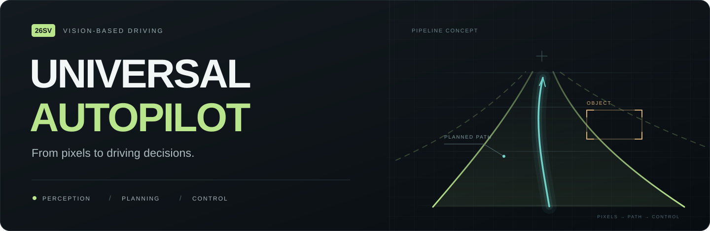
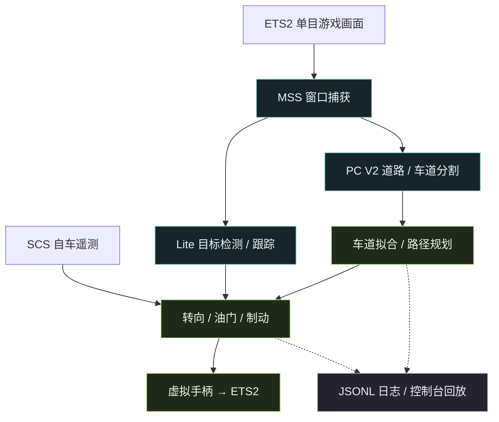

<div align="center">



### 看见道路，理解路径，输出控制。

基于视觉的驾驶辅助实验 · 从模型训练到 ETS2 控制，再到每一帧的可视化回放

**简体中文** · [English](README.en.md)

[](requirements.txt)
[](Models/pc_v2.py)


[项目亮点](#highlights) · [性能对比](#performance) · [输入与移植](#inputs) · [系统流程](#pipeline) · [快速开始](#quickstart) · [模型与训练](#training) · [代码导览](#code-map)

</div>

---

**Universal Autopilot（26SV）** 把一条驾驶辅助链路拆开、实现，并展示出来：屏幕画面经过神经网络，变成道路、车道和目标；这些结果进入路径规划与控制，最终通过虚拟手柄作用于游戏。中间过程会留下日志，方便逐帧检查一次转向或制动是怎样发生的。

当前运行入口接入 **Euro Truck Simulator 2 / Windows**。项目包含自定义 PyTorch 网络、BDD100K 训练代码、推理权重、本地控制台和离线测试。核心环境输入只有 **单目画面 + 车辆自身遥测**：不依赖游戏内部的道路地图、车道真值或其他车辆状态，便于将感知与规划逻辑复用到其他驾驶模拟器。

<a id="highlights"></a>

## 一条完整、看得见的驾驶链路

| 感知 · Perception | 规划与控制 · Planning & Control | 观察与复盘 · Inspection & Replay |
| :--- | :--- | :--- |
| **双头语义分割**：共享特征提取，道路 / 车辆与车道线分别预测 | **车道居中**：车道拟合、中心路径与随车速调整的预瞄转向 | **感知控制台**：车道、路径、目标和车辆状态同屏展示 |
| **三类目标检测**：行人、轿车、卡车，配合 NMS 与目标跟踪 | **手动请求换道**：结合可见车道与当前规划阶段生成路径 | **逐帧诊断**：记录转向、油门、刹车、遥测与制动原因 |
| **统一视觉输入**：RGB、640 × 352，分割结果参与车辆检测过滤 | **纵向控制**：目标速度 PI 油门与视觉 TTC 制动 | **日志回放**：选择历史运行、拖动时间轴、调整倍速、导出当前帧 |

<a id="performance"></a>

### Lite：帧率提升 50%

在 **NVIDIA GeForce RTX 4080 Laptop GPU（12 GB 显存）** 上，作者提供的实测运行帧率为：

| 检测方案 | 实测帧率 | 相对 YOLO26 |
| :--- | ---: | ---: |
| YOLO26 | 8 FPS | 1.00× |
| **Lite Detector** | **12 FPS** | **1.50×** |

**8 → 12 FPS，每秒处理帧数提升 50%。** 计算为 `(12 - 8) / 8 × 100% = 50%`。这是上述硬件上的项目运行记录，比较的是帧率，不代表检测精度提升，也不作为独立模型推理基准。

### 真实界面，不止是模型输出

<picture>
  <source media="(prefers-color-scheme: dark)" srcset="UI/preview-dark.jpg">
  <source media="(prefers-color-scheme: light)" srcset="UI/demo.jpg">
  
</picture>

<p align="center"><sub>仓库内的历史回放截图 · 支持深浅主题 · 截图中的速度和帧率是单帧记录，不代表性能基准</sub></p>

控制台将图像坐标中的车道、路径和检测框画在同一视图里，也能显示原程序的 `Result` 窗口。它只读取现有输出；网页上的暂停仅暂停显示。历史日志不包含视频，回放展示的是记录的结构与状态。详见 [控制台说明](UI/README.md)。

<a id="pipeline"></a>

## 从像素到控制



视觉负责道路与目标感知，SCS 遥测提供车速等车辆状态。转向与换道路径在图像坐标中计算；TTC 来自目标框变化的估计。

<a id="inputs"></a>

## 单目视觉 + 自车数据，便于移植

### 运行时读取什么

**环境感知来自一个视角的画面，车辆状态来自自车遥测。** 当前使用屏幕捕获取得 ETS2 的单目游戏画面；道路、车道线、目标框及相对运动由模型和后处理从画面中估计，不读取游戏内部的道路几何、导航路径、其他交通参与者坐标或速度真值，也不依赖深度图、雷达或激光雷达输入。

| 输入 | 来源与格式 | 实际用途 |
| :--- | :--- | :--- |
| **单目画面** | [`screen_capture.py`](MyAutoPilot/screen_capture.py) 通过 MSS 读取窗口客户区，或指定显示器；输出 BGR 图像 | 分割与检测各自缩放为 **640 × 352**、转为 RGB，并生成 `[1, 3, 352, 640]` 的 `float32` 张量，数值范围 `[0, 1]` |
| **自车遥测** | [`scs_telemetry.py`](MyAutoPilot/scs_telemetry.py) 只读打开 `Local\SCSTelemetry`，按 **revision 12** 解码 2,248 字节快照 | 提供车速等自车状态；当前转向和油门使用 `speed_kmh`，油门还检查 `status` |
| **用户操作** | Windows 键盘状态：左右方向键、上下方向键；OpenCV 的 `q` | 请求换道、调整目标速度与退出；属于用户指令，不提供环境真值 |
| **模型与参数** | 两份本地 `.pth` 权重，以及各模块中的阈值、增益和配置 | 初始化推理、筛选结果并计算控制，不需要运行时联网推理 |

### 自车遥测具体包含哪些字段

“只读取自车数据”并不等于“只读取车速”。读取器还解码以下自车状态，并将返回的遥测对象写入运行日志：

| 数据组 | 主要字段 | 当前用途 |
| :--- | :--- | :--- |
| **车速** | `speed_mps`、`speed_kmh` | `speed_kmh` 参与预瞄转向与 PI 油门，也显示在 HUD / 控制台 |
| **动力状态** | `engine_rpm`、`gear` | 状态显示与记录 |
| **驾驶输入与反馈** | `user_steer`、`game_steer`、`user_steer_right`、`game_steer_right`、`throttle`、`brake`、`clutch`、`game_throttle`、`game_brake` | 记录驾驶输入和游戏反馈；`*_right` 将转向符号统一为右转为正 |
| **自车位姿与运动** | `position_m`、`rotation_turns`、`local_velocity_mps`、`yaw_rate_ccw_rad_s`、`wheel_steering_deg` | 记录与诊断；当前路径规划不使用这些位置 / 姿态字段进行地图导航 |
| **有效性与时间** | `status`、`revision`、`sdk_active`、`paused`、`sdk_timestamp_us`、`simulated_time_us`、`read_timestamp`、`age_s` | 检查连接、协议、暂停与数据新鲜度；无效遥测下油门返回零 |

上表描述成功解码时的主要字段；缺失或不兼容的遥测会返回更精简的状态对象。自车遥测中的油门、刹车、转向反馈，与程序计算并写入日志的控制指令是两组数据，不能混为实际执行效果。

### 移植时需要适配哪里

输入不依赖 ETS2 的世界模型，因而核心视觉、车道处理和规划逻辑便于复用。迁移到其他驾驶模拟器时，主要适配以下边界：

| 适配点 | 当前文件 | 换一个模拟器时要做什么 |
| :--- | :--- | :--- |
| 画面获取 | [`screen_capture.py`](MyAutoPilot/screen_capture.py) | 接入新的窗口或单目图像源，确定视角与画面区域 |
| 自车状态 | [`scs_telemetry.py`](MyAutoPilot/scs_telemetry.py) | 将新的车辆数据接口映射为现有字段，尤其是车速与有效状态 |
| 控制输出 | [`input_controller.py`](MyAutoPilot/input_controller.py) | 将转向、油门、刹车映射到目标模拟器的控制接口 |
| 场景与车辆参数 | [`main.py`](MyAutoPilot/main.py)、[`steering.py`](MyAutoPilot/steering.py) 等 | 调整图像采样区域、阈值和控制增益，并验证模型在新场景中的表现 |

当前提供的是 ETS2 接入实现；更换场景仍需标定和闭环验证，视觉差异较大时可能需要重新训练。

### 控制台读取什么

控制台读取 `MyAutoPilot/logs/*.jsonl` 中的逐帧记录：外层为 `frame_id`、`elapsed`、`timestamp` 和 `data`；`data` 包含车道点、路径、跟踪目标、自车遥测、目标速度、控制指令和诊断信息。实时画面来自对 `Result` 窗口的独立截图。

**日志不保存原始摄像头视频或完整分割掩码。** 历史回放展示记录中的几何与状态；界面不会额外读取游戏世界数据，也不会把操作发送给车辆。

<a id="quickstart"></a>

## 快速开始

### 1 · 获取项目与依赖

以下命令使用 **Windows PowerShell**。建议先创建并使用自己的 Python 虚拟环境。

```powershell
git clone https://github.com/HenryG03124/Universal-Autopilot.git
cd Universal-Autopilot
python -m pip install -r requirements.txt
```

如需 GPU 推理，请按 [PyTorch 官方安装指引](https://pytorch.org/get-started/locally/) 选择匹配硬件的版本。运行时会自动选择可用设备；完整游戏捕获与控制链使用 Windows API。

**推理权重已包含在仓库中**，无需先训练模型：

| 文件 | 用途 |
| :--- | :--- |
| [`MyAutoPilot/weights/pc_model_v2_bdd100k.pth`](MyAutoPilot/weights/pc_model_v2_bdd100k.pth) | 道路、车辆与车道线分割 |
| [`MyAutoPilot/weights/od_model_Lite.pth`](MyAutoPilot/weights/od_model_Lite.pth) | 行人、轿车与卡车检测 |

### 2 · 先打开控制台

在仓库根目录运行：

```powershell
python -B -m UI.server
```

打开 **[http://127.0.0.1:8765](http://127.0.0.1:8765)**，或双击 `UI/start.bat`。界面没有前端构建步骤，也不依赖外部 CDN。

首次克隆不包含运行日志，因此暂时没有可回放的数据。运行 MyAutoPilot 后，控制台会读取 `MyAutoPilot/logs/` 下的 JSONL；也可以把已有日志放入该目录。查看实时画面时，保持 `Result` 窗口可见且无遮挡。运行截图与日志分别采样，不保证严格帧同步。

### 3 · 配置 ETS2 接入

| 项目 | 需要准备的内容 |
| :--- | :--- |
| 游戏窗口 | 默认标题为 `Euro Truck Simulator 2`；保持窗口可见、未最小化、无遮挡 |
| 虚拟控制器 | 按 [vgamepad 安装说明](https://github.com/yannbouteiller/vgamepad) 配置 Windows 驱动；在游戏中绑定左摇杆 X 为转向、右扳机为油门、左扳机为刹车 |
| 车辆遥测 | 安装与 [`truckermudgeon/scs-sdk-plugin`](https://github.com/truckermudgeon/scs-sdk-plugin) **revision 12** 兼容的插件；读取器使用 `Local\SCSTelemetry`，协议依据见 [`scs_telemetry.py`](MyAutoPilot/scs_telemetry.py) |
| 显示器 | [`main.py`](MyAutoPilot/main.py) 默认 `monitor_index = 2`；单显示器改为 `1`，窗口捕获模式也需要有效索引 |
| 控制开关 | 默认 `control = "enable"`；首次检查感知时可设为 `"disable"`。此时不发送驾驶指令，但仍会创建虚拟手柄，需要驱动 |

遥测缺失、过期、暂停或版本不兼容时，油门控制会返回零。请在游戏中解绑方向键的原有驾驶功能，避免与下表的操作冲突。

<details>
<summary><b>可选：自动调整 ETS2 转向设置</b></summary>

`main.py` 中的 `autoconfig` 默认关闭。可以保持该默认值，先退出 ETS2，再从仓库根目录单独运行配置工具。将下面的占位路径替换为自己的 `controls.sii` 完整路径：

```powershell
python -c "from MyAutoPilot.auto_config import auto_config; auto_config(r'C:\path\to\your\controls.sii')"
```

该功能调整转向相关设置、解除左右方向键的驾驶绑定，并保存一次 `controls.sii.bak` 备份。它不代替完整的手柄轴绑定，也不会解除上下方向键的驾驶绑定。完成后重新打开游戏，再启动 MyAutoPilot。

</details>

### 4 · 启动感知与控制

打开另一个 PowerShell，在**仓库根目录**运行：

```powershell
$env:PYTHONPATH = (Get-Location).Path
Set-Location MyAutoPilot
python -B main.py
```

请保留上述工作目录：权重通过 `weights/` 相对路径加载，而 `PYTHONPATH` 用于导入仓库根目录的 `Models`。

| 操作 | 行为 |
| :---: | :--- |
| `←` / `→` | 请求向左 / 向右换道，是否执行取决于车道可用性与规划状态 |
| `↑` / `↓` | 目标速度每次增加 / 减少 **5 km/h**，初始值为 **50 km/h** |
| `q` | 在 `Result` 窗口获得键盘焦点时退出 |

<a id="training"></a>

## 模型与训练

| 模块 | 设计 | 训练入口 |
| :--- | :--- | :--- |
| **PC V2** | 残差编码器 + U-Net 解码器；道路 / 车辆头与车道线头共享特征，车道分支融合原图细节 | [`NetTrainer/pixel_classifier_v2/train.py`](NetTrainer/pixel_classifier_v2/train.py) |
| **Lite Detector** | 自定义轻量残差网络；22 × 40 网格预测框、objectness 与三类目标 | [`NetTrainer/object_detector/train_Lite.py`](NetTrainer/object_detector/train_Lite.py) |

PC V2 在道路与车道任务之间交替训练，车道损失组合交叉熵与 Dice；检测器使用分类、Focal objectness 与 CIoU 回归损失。训练代码保留明确的数据加载、训练、验证、权重保存和绘图过程。

<details>
<summary><b>数据布局、训练命令与权重输出</b></summary>

数据统一放在 `NetTrainer/datasets/`，不随仓库分发。训练前需要自行获取 [BDD100K](https://www.bdd100k.com/) 数据并准备相应清单与标签：

```text
NetTrainer/datasets/
├── pc_ds/                    # 道路 / 车辆分割原始数据
├── processed_pc_ds/          # 道路 / 车辆分割清单与掩码
├── pc_lane_ds/               # BDD100K 车道原始数据
├── processed_pc_lane_ds/     # 车道分割清单与掩码
├── objdetect_ds/             # 检测原始图像
└── processed_objdetect_ds/   # 检测清单与标签
```

每个 `processed_*` 训练目录需要 `train_pairs.csv` 与 `val_pairs.csv`。训练数据和实时驾驶输入分开，BDD100K 的标注只用于离线监督训练：

| 训练任务 | CSV 必需列 | 读取内容与输出 |
| :--- | :--- | :--- |
| 道路 / 车辆与车道分割 | `stem`、`image_path`、`mask_path` | 原图与像素标签；图像为 `[3, 352, 640]`，掩码为 `[352, 640]`。道路标签为 0 背景 / 1 道路 / 2 车辆，车道标签为 0 背景 / 1 车道线，`255` 为忽略像素 |
| 目标检测 | `stem`、`image_path`、`annotation_path`、`width`、`height` | 原图与含 `boxes` / `labels` 的 JSON；原图像素坐标的框随图像缩放，输出 `[N, 4]` 的像素级 XYXY 框和 `[N]` 类别 |

图像使用 RGB `float32`、范围 `[0, 1]`；分割掩码使用 `int64` 和最近邻缩放，不除以 255。检测框为 `float32` 像素坐标，类别为 `int64`，框坐标不归一化。

CSV 中的相对路径以清单所在目录为基准。检测读取器支持 BDD100K 的 10 类标注；Lite 训练将其中的 person / car / truck 映射为模型类别 0 / 1 / 2。车道数据整理入口为 [`prepare_pc_v2_bdd100k_ds.py`](NetTrainer/pixel_classifier_v2/prepare_pc_v2_bdd100k_ds.py)，可通过下面的命令查看本地输入参数：

```powershell
python -m NetTrainer.pixel_classifier_v2.prepare_pc_v2_bdd100k_ds --help
```

仓库未提供完整的道路 / 车辆及目标检测数据整理流程，训练脚本直接读取已准备的数据。检测数据格式与损失说明见 [检测训练文档](NetTrainer/object_detector/README.md)。

数据就绪后，在仓库根目录运行所需任务：

```powershell
python -m NetTrainer.pixel_classifier_v2.train
python -m NetTrainer.object_detector.train_Lite
```

PC V2 权重与曲线写入 `NetTrainer/pixel_classifier_v2/`；检测器的 `od_model_Lite.pth` 与 `figure_Lite.png` 写入执行命令时的当前目录。要在游戏中使用新模型，需自行将对应权重更新到 `MyAutoPilot/weights/`。

</details>

<a id="code-map"></a>

## 代码导览

```text
Universal-Autopilot/
├── README.md / README.en.md         # 中英文项目说明
├── requirements.txt                # 推理、训练与可视化依赖
├── docs/assets/hero.svg             # README 封面
├── Models/
│   ├── pc_v2.py                     # 共享编码器、解码器与道路 / 车道分割头
│   └── od_Lite.py                   # Lite 三类目标检测网络
├── MyAutoPilot/
│   ├── main.py                      # 实时循环、运行参数与模块编排
│   ├── screen_capture.py            # MSS 窗口 / 屏幕捕获与 Win32 窗口定位
│   ├── scs_telemetry.py              # 只读解析 SCS revision 12 自车遥测
│   ├── pixel_classifier_v2.py        # 图像预处理、双头分割与掩码合并
│   ├── object_detector.py           # 检测推理、置信度筛选、NMS 与掩码过滤
│   ├── mov_detector.py              # 图像空间目标关联、ID 与相对运动状态
│   ├── lane_refiner.py              # 车道采样、拟合、可用性与中心点
│   ├── route_planner.py             # 车道居中 / 换道的路径选择与状态切换
│   ├── lane_change.py               # 换道请求、过渡路径与退出条件
│   ├── steering.py                  # 随车速调整的图像空间预瞄转向
│   ├── throttle.py                  # 目标速度管理与 PI 油门控制
│   ├── auto_brakes.py               # 本车道目标筛选、视觉 TTC 与制动请求
│   ├── input_controller.py          # 虚拟 Xbox 360 转向、油门与刹车输出
│   ├── auto_config.py               # 可选 ETS2 转向配置与 controls.sii 备份
│   ├── draw.py                      # Result 窗口的感知叠加与状态显示
│   ├── logger.py                    # 按帧写入带时间信息的 JSONL
│   ├── weights/
│   │   ├── pc_model_v2_bdd100k.pth   # 当前分割权重
│   │   ├── od_model_Lite.pth         # 当前检测权重
│   │   └── yolo26n.pt               # 保留的 YOLO26 权重；当前入口不加载
│   ├── tests/
│   │   ├── test_*.py                # 车道、规划、控制、配置与主流程离线测试
│   │   ├── profile_pipeline.py      # 分阶段计时；不输出游戏控制
│   │   └── replay_steering.py       # 用历史感知记录重算转向并比较指标
│   └── logs/                       # 运行时生成，Git 忽略
├── NetTrainer/
│   ├── pixel_classifier_v2/
│   │   ├── pc_v2_bdd100k_ds.py       # 道路 / 车道 CSV、图像与掩码读取
│   │   ├── prepare_pc_v2_bdd100k_ds.py # BDD100K 车道标注转掩码与清单
│   │   ├── train.py                 # 双任务训练、验证、保存与绘图
│   │   ├── test.py                  # 单图分割与掩码导出
│   │   ├── pc_model_v2_bdd100k.pth   # 训练目录中的分割权重
│   │   └── figure_v2_bdd100k.png     # 已保存的训练曲线
│   ├── object_detector/
│   │   ├── bdd_objdetect_ds.py       # 图像、检测 JSON 与变长目标 batch
│   │   ├── train_Lite.py             # 三类检测训练、AP50 等验证与保存
│   │   ├── test_Lite.py              # 单图检测可视化
│   │   ├── figure_Lite.png           # 已保存的训练曲线
│   │   └── README.md                 # 检测标签、输入格式与损失说明
│   ├── pixel_classifier/            # 早期 LiteCNN / ResNet / U-Net 实验
│   │   ├── bdd_pc_ds.py              # 早期道路 / 车辆分割数据读取
│   │   ├── train_*.py / test_*.py     # 早期训练与单图测试
│   │   └── *.pth / *.png / *.jpg     # 已保存权重、曲线与示例
│   └── datasets/                    # 本地原始数据与 processed_* 清单，Git 忽略
└── UI/
    ├── server.py                    # 本地 HTTP 服务、日志索引与 Result 截图
    ├── index.html                   # 控制台页面结构
    ├── app.js                       # 数据请求、感知绘制、状态与回放交互
    ├── style.css                    # 布局与深浅主题
    ├── start.bat                    # Windows 启动入口
    ├── test_server.py               # 日志读取、回放与路径边界测试
    ├── README.md                    # 控制台使用说明
    └── *.jpg / favicon.svg          # 界面预览与图标
```

单图测试工具需要按脚本中的路径准备测试图片与权重；性能分析和日志回放工具用于局部诊断，并非上文 YOLO26 / Lite 对比的自动复现脚本。

想读懂一次驾驶决策，可以从 [`main.py`](MyAutoPilot/main.py) 开始，沿着 [`lane_refiner.py`](MyAutoPilot/lane_refiner.py) → [`route_planner.py`](MyAutoPilot/route_planner.py) → [`steering.py`](MyAutoPilot/steering.py) 追踪数据，再对照日志中的 `path_points`、`steering_debug` 和 `brake_reason`。

离线测试入口，在仓库根目录执行：

```powershell
python -B -m unittest discover -s MyAutoPilot/tests -v
python -B -m unittest UI.test_server
```

可以从 [转向测试](MyAutoPilot/tests/test_steering.py) 与 [规划测试](MyAutoPilot/tests/test_route_planner.py) 查看具体检查项。离线测试用于检查局部逻辑，不能代替游戏中的闭环验证。

## 当前边界与参与方式

这是用于学习与实验的驾驶辅助项目。换道可用性来自车道与规划状态，不包含完整侧后方安全检查；视觉 TTC 不是雷达测距；项目目前也没有完整的路线导航或路口决策。运行效果会受到模型、视角、画面遮挡与机器性能影响。

欢迎通过 [Issues](https://github.com/HenryG03124/Universal-Autopilot/issues) 提供可复现的问题，或通过 [Pull Requests](https://github.com/HenryG03124/Universal-Autopilot/pulls) 改善模型、控制和文档。报告问题时，附上运行环境、配置与相关日志片段会更有帮助。

项目使用 [PyTorch](https://pytorch.org/)、[OpenCV](https://opencv.org/)、[MSS](https://github.com/BoboTiG/python-mss)、[vgamepad](https://github.com/yannbouteiller/vgamepad)、[BDD100K](https://www.bdd100k.com/) 与 [SCS SDK Plugin](https://github.com/truckermudgeon/scs-sdk-plugin)。数据、第三方组件与游戏内容遵循各自的许可条款。

---

<p align="center"><b>From pixels to driving decisions.</b><br><sub>Universal Autopilot · 26SV</sub></p>
